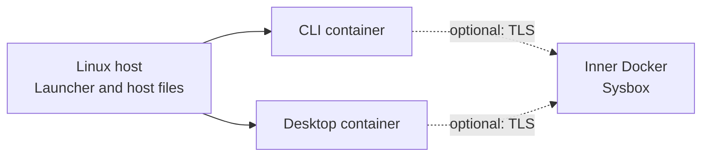
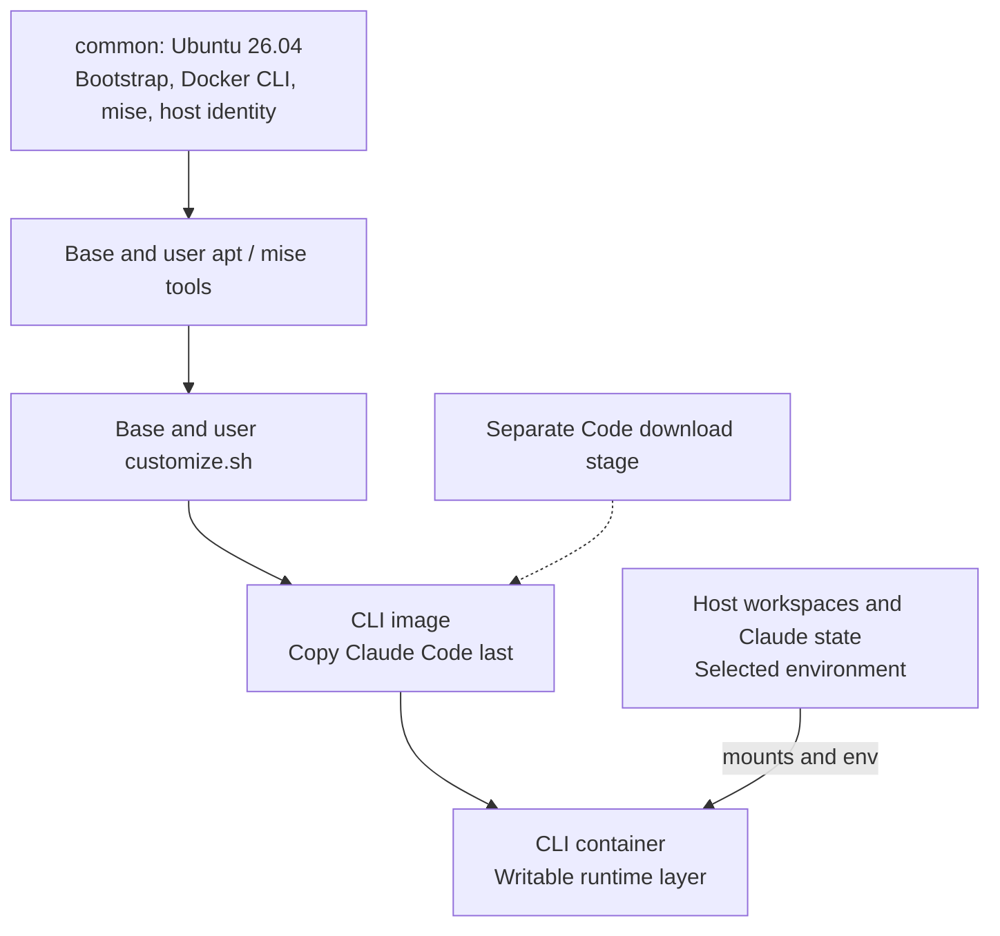

# Claude in Docker for Linux

## What the program does

Run Claude Code CLI and Claude Desktop in Ubuntu 26.04 containers on Linux.
The launcher uses your host account, UID, GID, and home directory by default.
Workspaces keep the same absolute paths inside the containers.
Inner Docker is optional and disabled by default.



<details>
<summary>CLI: image layers and runtime</summary>



</details>

<details>
<summary>Desktop: image layers and runtime</summary>



</details>

```mermaid
flowchart TB
  B["common: Ubuntu 26.04<br/>Bootstrap, Docker CLI, mise, host identity"]
  B --> G["Desktop libraries and Openbox"]
  G --> T["Base and user apt / mise tools"]
  T --> H["Base and user customize.sh"]
  H --> A["Install Claude Desktop"]
  K["Separate Desktop package stage"] -.-> A
  A --> I["Desktop image<br/>Copy Claude Code last"]
  C["Separate Code download stage"] -.-> I
  I --> R["Desktop container<br/>Writable runtime layer"]
  P["Host workspaces and Claude state<br/>Selected environment"] -->|"mounts and env"| R
  R -->|"X11"| X["Host Xephyr window"]
```

Boxes group build steps. Claude artifacts are added after tool setup, so
version-only updates can reuse earlier layers. Host mounts persist separately
from the writable container layer.

## Security model

Mounted paths give Claude read and write access to host files. Use narrow
workspace roots and forward only the environment variables you need.
Process environments are not secret stores: Claude, its child processes, the
Docker daemon, and users who can inspect processes can read forwarded values.

Docker group membership is root-equivalent. Containers share the host kernel;
they do not protect against a hostile host administrator. This project never
mounts the host Docker socket and does not use privileged mode.

Desktop enables the Chromium sandbox and uses a private authenticated display.
Clipboard sync and `--no-sandbox` require explicit opt-in and can expose secrets
or remove an isolation layer. Run only host hooks and build scripts you trust.

## Requirements

- Linux on amd64 (x86_64) or arm64 (aarch64).
- Python 3.11 or newer.
- Docker Engine with the Docker Compose v2 plugin.
- Docker access as your normal user; the root account is not supported.

The launcher does not install host packages or change Docker settings.
CLI image checks passed on Debian 13 amd64. Desktop with the explicit Chromium
policy passed on Docker 29.10.0 and Debian 13 amd64. arm64 remains untested.
See the [qualification matrix](docs/reference.md#requirements) for exact limits.

## Install

Use a trusted release archive or source checkout. From its directory:

1. Install the launcher:

   ```bash
   ./install
   ```

   Add `$HOME/.local/bin` to `PATH` in your shell startup file if needed:

   ```bash
   export PATH="$HOME/.local/bin:$PATH"
   ```

2. Create configuration, then edit its workspace roots:

   ```bash
   claude-docker config init
   ```

   Edit `~/.config/claude-docker/config.toml`. Set `mounts` in `[container]`
   to existing directories, for example `["~/work/git"]`.

3. Optional: create a personal tool profile, edit it, then lock its tools:

   ```bash
   claude-docker tools init
   ```

   Edit `~/.config/claude-docker/mise.toml`, then run:

   ```bash
   claude-docker tools lock
   ```

4. Optional: create and review a personal build script:

   ```bash
   claude-docker customize init
   ```

   Edit `~/.config/claude-docker/customize.sh` before building. The example
   installs `checkbashisms` and Google Cloud CLI as root. It needs no tools lock.

5. Check the host and build both images:

   ```bash
   claude-docker check
   claude-docker build
   ```

   Use `claude-docker build --only-cli` if you need only Claude Code.

Init commands do not overwrite existing files. Without steps 3 and 4, builds
use only the base tools. The command link is `~/.local/bin/claude-docker`;
program releases are under `~/.local/share/claude-docker/releases`.

## Start Claude

From a configured workspace:

```bash
cd ~/work/git
claude-docker cli
claude-docker cli --resume
```

All arguments after `cli` go to Claude Code unchanged, including `--help`.
Outside a mounted workspace, Claude starts in the configured container home.

Run `claude-docker` or `claude-docker --help` for help without loading config
or using Docker. Put `-d` or `--debug` before a command to show config and build
input paths, including missing files. This also works before `--help` and
`--version`. Normal starts show versions, without paths. Diagnostics use stderr.

```bash
claude-docker -d check
claude-docker stop
```

`stop` removes the containers and recorded display services. It preserves state
in enabled host mounts and data in named inner Docker volumes. If another
launch, restart, or stop is in progress, wait and retry. The lock is released
before the interactive CLI session, so you can then start more CLI sessions.

## Configure the program

See [config.example.toml](config.example.toml) for all keys. Process environment
overrides take precedence over TOML, then detected host defaults. Identity
settings can override the container user, UID, GID, and home.

```toml
[container]
mounts = ["~/work/git", "/srv/shared-projects"]
```

Mount roots must exist. Paths must be absolute or start with `~/`.
Use `mounts = []` to disable workspace mounts. Without configuration, the
workspace default is `~/work/git`.

| Host input | Default |
| --- | --- |
| Launcher config | `~/.config/claude-docker/config.toml` |
| Personal tools and lock | `~/.config/claude-docker/mise.toml` and `mise.lock` |
| Personal build script | `~/.config/claude-docker/customize.sh` |
| Claude state mounts | `~/.claude`, `~/.claude.json`, `~/.config/Claude` |

Missing state directories are created before launch. The JSON file is mounted
only if it exists. You can override or disable each state mount. Data stored
only inside a container is lost when that container is removed.

`CLAUDE_CONFIG_FILE` selects another config. `CLAUDE_MISE_CONFIG_FILE` selects
another tool profile. Absolute XDG base-directory variables change host storage
locations. See the [configuration reference](docs/reference.md#configure-the-program)
for storage paths, mount overrides, and environment forwarding.

List forwarded variable names in `[environment].required` or `optional`, then
export their values on the host. Required values must be nonempty. A trusted
Bash `[hooks].pre_launch` script can generate credentials or prepare mounted
files before launch. Each new CLI process receives current values; restart
Desktop to refresh its credentials. See the [AWS hook example](docs/reference.md#prepare-credentials-and-files-before-launch).

Personal tools and the build script survive launcher updates, uninstall, and purge.
After editing tools, run `tools lock`, then build. The build script runs as root
after tool setup and before Claude installation. Manual package installations
inside running containers are lost on removal. See [tools and packages](docs/reference.md#add-image-tools-and-packages),
[mise activation](docs/reference.md#activate-mise-in-claude-code), and the
[CLAUDE.md example](docs/reference.md#tell-claude-code-which-tools-to-use).

### Optional shell aliases

Add to `~/.bashrc`, then run `source ~/.bashrc`. For Zsh, use `~/.zshrc`.
The `claude` alias takes precedence over a host command with the same name.

```bash
alias claude='claude-docker cli'
alias claude-desktop='claude-docker desktop'
alias claude-stop='claude-docker stop'
alias claude-build='claude-docker build'
alias claude-rebuild='claude-docker build --rebuild'
alias claude-update='claude-docker update'
```

The aliases pass arguments, for example `claude --resume`. For an uninstalled
checkout, use its quoted absolute path instead of the launcher name:

```bash
alias claude='"$HOME/work/claude-docker/claude-docker" cli'
```

## Use Claude Desktop

Use a graphical session with `DISPLAY` set; Wayland needs XWayland.
On Debian or Ubuntu, install the display tools:

```bash
sudo apt install xserver-xephyr xauth x11-xkb-utils xclip
claude-docker check --desktop --clipboard
claude-docker desktop
```

The container UID must match the host UID. Close a host Claude app using the
shared profile to avoid locks. Resize the Xephyr window to resize Claude.
Alt+Shift switches between US and Russian; keyboard settings are configurable.

The default is `seccomp = "default"` in `[desktop]`. To opt into the Chromium
policy, use `seccomp = "chromium"`. It requires Linux amd64 and builtin seccomp.
The launcher selects and caches a policy for the Docker daemon; Docker updates
select a new entry. It expands permitted namespace operations, so keep the
internal sandbox enabled. See [Desktop settings](docs/reference.md#use-claude-desktop)
and [security evidence and limits](docs/desktop-security.md) before enabling it.

Clipboard transfer is manual by default. Review its contents before transfer;
it can contain secrets:

```bash
claude-docker desktop-clipboard push
claude-docker desktop-clipboard pull
claude-docker desktop --restart
```

`push` copies host to Desktop; `pull` copies Desktop to host. Per-run settings
and credentials persist until restart or stop. `desktop --restart` applies
current settings and the rebuilt image without stopping CLI or inner Docker.

## Use inner Docker

Install Sysbox and register `sysbox-runc`, then:

1. Stop the containers:

   ```bash
   claude-docker stop
   ```

2. Set this top-level value in TOML:

   ```toml
   docker_mode = "sysbox"
   ```

3. Check the host, pull images, and start CLI:

   ```bash
   claude-docker check
   claude-docker pull
   claude-docker cli
   ```

Ubuntu 24.04 is the intended reference host. Debian 13 is experimental:
filesystem hangs can make the host unresponsive. Live Sysbox qualification
remains open, including Desktop with the Chromium policy. Do not rely on Sysbox
for host isolation on unsupported hosts, including Debian 13.

The inner daemon uses mutual TLS and a managed volume. Desktop starts or
repairs it as needed, without recreating running containers. To disable it,
stop the containers and set `docker_mode = "none"`. See [inner Docker details](docs/reference.md#use-inner-docker).

## Check the system

`claude-docker check` is read-only. Use `--desktop`, `--clipboard`, or
`--clipboard-sync` to check optional prerequisites. Desktop checks describe
policy for the next start; they do not verify a running Desktop lifetime.

`claude-docker check --smoke` creates and removes a temporary container.
It checks basic execution, not the Chromium sandbox or a complete inner Docker
workload. Missing environment variables are reported without their values.

## Update or uninstall

Run `./install` from a newer trusted release to update the launcher.
For changed sources with the same version, uninstall without `--purge`, then
install again. User configuration and build inputs are retained.

```bash
claude-docker update
claude-docker update --only-cli
claude-docker update --only-desktop
claude-docker build --rebuild
```

`build` uses saved versions; the first build saves missing pins. `update`
checks the latest versions and builds. Both select both images by default;
`--only-cli` and `--only-desktop` select one. Add `--rebuild` to either command
to pull fresh base images and skip the cache. Code auto-updates are disabled
inside containers. Ordinary updates can reuse package and customization layers.

These commands do not restart running containers. Use `claude-docker stop`
before starting CLI from a new image, or `claude-docker desktop --restart` for
Desktop. See [version selection](docs/reference.md#update-claude-code-or-desktop).

```bash
claude-docker uninstall
claude-docker uninstall --purge
```

Normal removal retains config, user data, images, networks, and volumes.
Purge requests an inventory and confirmation before removing eligible launcher
config and managed Docker storage. Both modes retain workspaces, Claude state,
personal tools, version pins, and build scripts. See [system installation and
removal recovery](docs/reference.md#uninstall) for shared installs, `--yes`,
ownership checks, and interrupted removal.

## TODO

- [ ] Add CI for tests, image builds, and release archive checksums.
- [ ] Complete interactive CLI checks on Debian 13 and Ubuntu 24.04; test arm64.
- [ ] Extend Desktop tests to login, resume, real profiles, host clipboard,
  the internal GPU sandbox, and other Docker versions.
- [ ] Test Sysbox on Ubuntu 24.04, investigate Debian 13 hangs, and qualify
  Desktop with Chromium seccomp in Sysbox mode.
- [ ] Test shared installation and removal with separate real accounts.

## License

Copyright (C) 2026 Claude in Docker for Linux contributors.
Original code and documentation: GNU GPL version 3 only (`GPL-3.0-only`),
without warranty. See [LICENSE](LICENSE). Moby seccomp profiles use Apache 2.0;
see their [license](security/LICENSE.moby-profiles) and [notice](security/NOTICE.moby-profiles).
Claude and other third-party software retain their own licenses.
